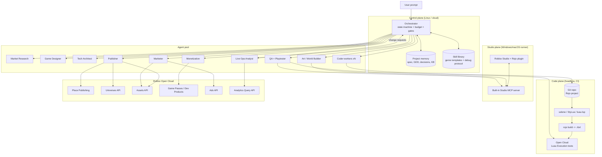

# RobloxAutoBuild — System Architecture

> One prompt in → a designed, built, tested, published, and marketed Roblox experience out.

Status: design proposal (v0.1, Oct 2026). Research and sources are in [RESEARCH.md](./RESEARCH.md).

---

## 1. Goals and non-goals

**Goals**

- A user types one prompt (for example *"a cozy fishing simulator with pets and trading"*). The system produces a playable Roblox experience, publishes it, sets up monetization, and runs a launch marketing campaign.
- Every step is reproducible from source control. The game lives as a Rojo project in git, not as an opaque `.rbxl`.
- The system checks its own work by building, testing, playtesting, and judging what it made before it ships.
- After launch it keeps improving the game from analytics (live ops).

**Non-goals (v1)**

- Large, original genres such as MMOs, competitive shooters, or complex strategy. Section 9 explains why these are hard for agents.
- Bypassing anything Roblox requires a human for: account and ID verification, payment methods, legal attestations.
- Mass-producing low-effort games. Roblox moderates spam and misleading content. One good game beats ten clones.

### The honest version of "completely autonomous"

Everything in the pipeline can be automated **except** a short list of account-level steps that Roblox ties to a real person:

- the account and its verification
- the ad billing method
- the content maturity questionnaire
- possibly the first switch from private to public

The design treats these as **approval gates**. By default they pause and ask the owner. In "full auto" mode, a gate passes on its own if the owner pre-approved it (for example, ads approved up to $X). After a one-time setup, a single prompt really is enough.

---

## 2. Key platform facts that shape the design

| Fact | Consequence |
|---|---|
| Roblox Studio runs only on Windows and macOS. Its **built-in MCP server** (Assistant → Manage MCP Servers) exposes tools for scripts, assets, Luau execution, playtesting, simulated input, and screen capture. | You need a **Studio Runner** on a Windows or Mac machine (or VM). The headless parts run anywhere. |
| Roblox archived the official `studio-rust-mcp-server` in Apr 2026 in favor of the built-in server. | Build on the built-in server, not the archived repo. |
| **Rojo** syncs a folder of `.luau` files into Studio and can build `.rbxl` files headlessly. | Code is the source of truth. CI builds the place file without Studio. |
| **Open Cloud Luau Execution API** runs Luau headlessly inside a place: 5-minute tasks, 10 concurrent tasks per place, roughly 5 calls per minute per key owner. | Unit and integration tests can run in CI on Linux. Batch the tests, because the quota is small. |
| **Open Cloud Place Publishing** (`universe-places:write`) uploads and publishes a place version. | Publishing is a single API call from CI. |
| **Universes API** (`universe:write`) updates the name and description (through the root place). Thumbnails use a **legacy** endpoint. | Store-page text is automated. Thumbnails may break and need a fallback. |
| **Game Pass and Developer Product APIs** (create, update, list) were added around Dec 2025. | Monetization setup is automated. |
| The **Ads API** (`ads-management/v1`) creates ENGAGEMENT campaigns with daily or lifetime budgets in micro-USD. Campaigns go through policy review, and cancellation is permanent. | The marketing agent can run on-platform ads within a hard budget cap. |
| The **Analytics Query API** is in beta (`universe.analytics:read`). | The live-ops loop can read retention, session time, and revenue. Wrap it behind an adapter, since beta APIs change. |
| Studio exposes `generate_mesh`, `generate_material`, and `generate_procedural_model` (Cube 3D / 4D). | 3D assets can be generated in-engine, with no external 3D pipeline. |

---

## 3. High-level architecture



### 3.1 Control plane

- **Orchestrator.** A long-running agent built on the Claude Agent SDK. It owns a **pipeline state machine** (section 4). It does not write game code itself. It sends tasks to specialist agents, checks their outputs against each phase's exit criteria, and enforces the budget.
- **Project memory.** Structured artifacts in the repo: `spec.yaml`, `gdd.md`, `tasks.yaml`, `decisions.md`, `assets.lock.json`. Agents receive only what their task needs. This keeps context small, the same way OpenGame reads its docs in layers.
- **Skill library.** The single most important quality lever (see section 5):
  - **Genre templates:** working skeletons with extension hooks.
  - **Debug protocol:** a growing list of error signature → root cause → verified fix.
  - **Roblox API notes:** curated docs, so agents don't invent APIs that don't exist.
- **Budget and guardrails service.** Tracks spending on model tokens, Robux, and ad USD. It enforces hard caps, and it is the only component that can unlock an approval gate.

### 3.2 Agent pool

| Agent | Model tier | Inputs → outputs |
|---|---|---|
| Market Research | mid | prompt → `market.md`: comparable top games, their core loops, gaps, a target audience, and a working title |
| Game Designer | frontier | prompt + market → `gdd.md`: core loop, progression, economy, a list of systems, a list of art needs, and **acceptance tests in plain language** |
| Tech Architect | frontier | GDD → picks a genre template, maps GDD systems to template hooks, writes `tasks.yaml` (file-level tasks with dependencies) |
| Coder workers | mid, in parallel | one task → Luau module + unit test, through git branches merged by the orchestrator |
| Art / World Builder | mid + Studio tools | art list → meshes and materials generated with Cube, Creator Store assets via `search_asset`/`insert_asset`, terrain and lighting. Writes `assets.lock.json` |
| QA + Playtester | mid + vision | builds → runs headless tests, then Studio playtests (`start_stop_play`, `character_navigation`, `screen_capture`, `get_console_output`). Screenshots are scored by a vision judge against the GDD |
| Monetization | mid | GDD economy → game passes and developer products through Open Cloud, plus a `ProcessReceipt` handler from the template |
| Publisher | small | green build → place publish, name and description, icon and thumbnails, social links |
| Marketer | mid | GDD + screenshots → store copy, ad creatives, Ads API campaign within budget, optional trailer clips for off-platform channels |
| Live Ops Analyst | mid | analytics → ranked change requests (for example "D1 retention 9%, tutorial drop-off at step 3") that go back into the pipeline |

**Budget setup (single PC + Claude Pro):**
- Run everything on the owner's Windows PC.
- The orchestrator is Claude Code itself, run headless (`claude -p`) from a script and signed in with the Pro subscription. A separate API-billed Agent SDK app would add per-token costs.
- Studio's built-in MCP server and Rojo run on the same machine.
- High-volume, low-stakes work (captions, image prompts, asset variations) can run on local models on the GPU.
- When Pro usage limits are reached, the pipeline pauses and resumes in the next usage window instead of switching to paid API usage.

Model tiers are deliberately abstract. Use the strongest available model for the planning and design roles and cheaper models for high-volume workers. Check the current lineup when implementing.

### 3.3 Code plane (headless, runs on Linux CI)

```
rojo build  →  selene + StyLua + luau-lsp --analyze  →  upload test place (Open Cloud)
            →  Luau Execution: run TestEZ/Jest-Lua suites  →  parse results  →  pass/fail
```

- Every coder task must ship with a test. The orchestrator rejects a merge if lint, typecheck, or tests fail.
- Tests run against a **separate private "staging" place** in the same universe. Production is never touched before the release gate.
- Luau Execution quotas are small, so the test runner **batches all specs into one task** per build.
- Use Wally for packages. Install them *before* `rojo build`, a known CI pitfall.

### 3.4 Studio plane (Windows or macOS runner)

The built-in MCP server can only reach a running Studio. So:

- A dedicated Windows VM (or a Mac) runs Studio logged in to the bot account, with the Rojo plugin connected to `rojo serve`. It also runs a small **runner daemon** that connects to the control plane.
- The daemon exposes Studio's MCP tools to the agents (through an MCP proxy or relay). It serializes access, because a single Studio session is single-tenant.
- Studio is used for things the headless plane can't do:
  - visual world building
  - Cube mesh and material generation
  - real **client** playtests with simulated input
  - screenshots for the visual judge and for marketing
- **Anything Studio produces that is not code** (terrain, built models, lighting) is exported back to the repo as `.rbxm`/`.rbxmx` model files, or kept in the place as partially managed Rojo, so the build stays reproducible.

### 3.5 Roblox integration layer

A thin typed client (TypeScript or Python) wraps each Open Cloud API behind an interface:

- `PlacePublisher`, `UniverseConfig`, `AssetUploader`, `MonetizationConfig`, `AdsManager`, `Analytics`
- Retries with exponential backoff on 429 responses, plus idempotency keys (the Ads API supports `x-idempotency-key`).
- **One API key per concern, with the smallest scopes it needs**, stored in a secrets manager. Example: the marketer's key has `ad.campaign:*` only.
- Beta and legacy endpoints (Analytics, thumbnails) are behind adapters with fallbacks. If they break, the system degrades to "ask a human".

---

## 4. Pipeline (state machine)

Each phase has **exit criteria**. A phase that fails retries up to N times with the failure context, then escalates to a human.

| # | Phase | Exit criteria (machine-checkable where possible) |
|---|---|---|
| 0 | **Intake** | Prompt expanded into `spec.yaml`: genre, audience age band, platform targets, budget caps, autonomy level |
| 1 | **Market research** | `market.md` lists 5+ comparable experiences with core loops, plus a differentiation statement |
| 2 | **Design** | `gdd.md` passes a schema check. Each system has acceptance tests. A critic agent scores it ≥ threshold for fun, scope, and feasibility |
| 3 | **Scaffold** | Genre template instantiated. `rojo build` succeeds. The template's own tests pass |
| 4 | **Implement** | All `tasks.yaml` items merged. Lint, typecheck, and unit tests pass |
| 5 | **World and assets** | Every art need in the GDD resolves to an asset ID in `assets.lock.json`. The map has spawn points and is navigable |
| 6 | **Verify** | Headless integration tests pass. A Studio playtest runs every GDD acceptance test with no console errors. The vision judge rates visuals and intent ≥ threshold. Performance budget met (part count, script time) |
| 7 | **Monetize** | Passes and products created. Receipt handler tested. Prices sanity-checked against comparable games |
| 8 | **Release** ⛳ gate | Place published. Name, description, icon, thumbnails, and genre set. Maturity questionnaire answered (human gate the first time). Experience made public |
| 9 | **Market** ⛳ gate | Ad creatives uploaded. Campaign created within the approved budget. Delivery status reaches SERVING (or a REJECTED reason is handled) |
| 10 | **Live ops** (loop) | Daily: pull analytics → produce change requests → re-enter phase 2 or 4 with a small scoped diff → a staging check → publish |

⛳ = approval gate. It skips itself when the owner has pre-approved it in `spec.yaml`.

**Portfolio mode (recommended default).** Roblox outcomes follow a power law, and paid ads rarely pay back for anything short of a hit (see [HISTORY_AND_ROI.md](./HISTORY_AND_ROI.md)). So the orchestrator runs phases 0–9 as a **cheap prototype with a small soft-launch ad budget**, then applies a **kill/keep rule** based on D1 retention and session length after 3–7 days. Only kept games get the full live-ops loop and bigger ad budgets. Killed games add what was learned to the KB.

```mermaid
stateDiagram-v2
    [*] --> Intake
    Intake --> Research --> Design --> Scaffold --> Implement --> World --> Verify
    Verify --> Implement: test/playtest failures
    Verify --> Monetize
    Monetize --> Release
    Release --> Market
    Market --> LiveOps
    LiveOps --> Design: feature change
    LiveOps --> Implement: bug / tuning
    LiveOps --> Market: creative refresh
```

---

## 5. Making it actually work: the skill library

The strongest lesson from comparable systems (OpenGame, Ropilot, Roblox's own Assistant): **free-form "write a whole game" generation fails. Constrained structure plus cumulative debugging succeeds.**

### 5.1 Genre templates ("kits")

Each kit is a complete, tested Rojo project with **hook points**. Agents fill in hooks instead of inventing the architecture.

```
templates/
  _core/                 # shared: data persistence (DataStore + session locking), player
                         # profiles, remote event wrapper, UI framework, analytics events,
                         # receipt processing, settings, anti-exploit basics
  obby/                  # checkpoint stages, kill bricks, timers, leaderboards
  tycoon/                # plots, droppers, conveyors, upgrades, rebirth
  simulator/             # click/collect loop, pets, zones, eggs, multipliers
  tower-defense/         # waves, paths, towers, upgrades
  round-based/           # lobby → round → results loop (minigames, survival, hide & seek)
  roleplay-hangout/      # housing, jobs, vehicles, social spaces
```

Each kit ships with:

- `kit.yaml`: the hooks, the config schema, and which GDD systems map to which hooks
- a test suite
- a reference playtest script
- a balance sheet (economy numbers)

The Tech Architect's main job is *choosing a kit and mapping the GDD onto it*.

**Classify by mechanics, not by genre labels.** "Fishing simulator with trading" is the `simulator` kit plus a `trading` module. Use a capability matrix, not a lookup by marketing genre.

### 5.2 Debug protocol (the system's long-term memory)

`kb/debug/*.md` entries look like:

```yaml
signature: "attempt to index nil with 'Character'"
context: "server script runs before character spawn"
root_cause: "PlayerAdded handler accesses player.Character synchronously"
fix: "use player.CharacterAdded:Wait() or CharacterAdded connection"
precheck: "grep for '.Character.' inside PlayerAdded handlers"
verified_in: [run-0142, run-0178]
```

- When any failure occurs, the agent searches this KB first.
- When the agent fixes something new and verifies the fix, it appends an entry.
- High-frequency entries become **pre-execution lint rules**.

### 5.3 Roblox API grounding

- Mirror the Creator Hub docs (Roblox publishes `llms.txt` indexes) into a local search index. Agents must cite an API page before they use an unfamiliar service.
- `luau-lsp` with the current Roblox type definitions catches hallucinated APIs at typecheck time, before anything runs.

---

## 6. Verification strategy

Verification is layered from cheap to expensive:

1. **Static:** StyLua, selene, and `luau-lsp --analyze` (strict mode on generated code).
2. **Unit tests:** TestEZ or Jest-Lua, run through Open Cloud Luau Execution on the staging place.
3. **Server simulation tests:** spawn fake players, run the economy for N simulated minutes, assert there is no currency overflow and progression stays on pace.
4. **Studio client playtest:** the playtest agent drives the character through scripted scenarios derived from the GDD's acceptance tests ("player can buy first upgrade within 2 minutes"). It reads console output and captures screenshots.
5. **Vision judge:** a vision-capable model scores screenshots for readability, visual coherence, UI overlap on phone-sized viewports, and match to intent.
6. **Fun proxy (post-launch):** real retention data. This is the only true judge. Phase 10 exists because steps 1–5 can't measure fun.

---

## 7. Marketing subsystem

**On-platform (automated through APIs)**

- Store page: title, description, and genre are optimized from market research. Icon and thumbnails are rendered from Studio `screen_capture` plus generated overlays.
- Sponsored experiences through the Ads API:
  - Upload creatives via the Assets API, check `campaign-options`, then `POST /campaigns` with an idempotency key.
  - Start with a small DAILY budget and poll `batchGetStatus`.
  - Scale only if retention passes a threshold. Ads can't fix a bad core loop, so they shouldn't pay to send players into one.
- Live events and updates: a "what's new" description refresh with each update.

**Off-platform (optional, human-approved by default)**

- A trailer and short-form clips (YouTube Shorts, TikTok), assembled from scripted Studio camera flythroughs.
- Posts to a Roblox group, Discord, and X via their respective APIs.
- Each channel's posting is behind its own gate and credentials.

**Guardrails**

- A hard USD cap per campaign and per month, enforced by the Budget service, not by the agent.
- No misleading creatives: every ad image must be a real screenshot or a direct derivative of one.
- The audience age band comes from the spec, and copy is checked against Roblox ad policy before submission.

---

## 8. Safety, compliance, and cost controls

- **Roblox Terms and Community Standards:**
  - A rate limit of one new public experience per N days.
  - Content moderation pre-checks on all generated text and images.
  - The maturity questionnaire is answered truthfully from the GDD, and a human confirms it the first time.
- **Child safety:** the Roblox audience skews young.
  - No external links in game.
  - Use `TextChatService` filtering for any user-to-user text.
  - No dark-pattern monetization: no paid loot boxes, and prices are shown clearly.
- **Secrets:** API keys are scoped per agent and stored in a vault. Never commit passwords, cookies, or API keys to the repo.
- **Accounts:** the owner account is **`robotrevolution`**. Recommended setup:
  - Create a **Roblox group owned by `robotrevolution`** and publish every game under that group. Revenue then pools in one place, and other accounts can be given limited roles.
  - Create the Open Cloud API keys from `robotrevolution` (or the group). Scope each key to that group's universes only.
  - The Studio runner signs in with either `robotrevolution` (simplest) or a separate bot account that has a builder role in the group. The bot account is safer: if the runner machine is compromised, it can't touch account settings, Robux, or DevEx.
  - Enable 2-step verification. Cashing out through DevEx needs the account holder's own ID verification and a tax form, and only a human can do that.
- **Blast radius:** agents can only publish to the configured universe IDs. Staging and production are different places.
- **Cost:** per-run token budgets for each phase, plus a cache of research and docs. Small, cheap models do classification and summarization. The run aborts with a report when a cap is reached.
- **Audit log:** every external write (publish, product create, ad create) is logged with inputs and outputs. This makes a run reviewable and reversible where the API allows.

---

## 9. Known hard problems and mitigations

| Problem | Mitigation |
|---|---|
| Agents struggle with abstract logic (strategy, puzzles): errors pass silently | Start with physics- and loop-centric kits (obby, tycoon, simulator). Use property-based simulation tests for economies |
| "Is it fun?" is not machine-checkable | Use small, safe launches, then retention-driven iteration (phase 10). A/B tests where available |
| Studio is GUI-only and needs Windows or macOS | A dedicated runner VM. Keep Studio's role narrow (world, playtest, capture) and push everything else headless |
| Beta and legacy APIs change (Analytics, thumbnails) | Adapter interfaces, contract tests run nightly, and "ask a human" fallbacks |
| Luau Execution quotas are small | Batch tests and cache builds. Run only affected suites for small diffs |
| Generated assets look inconsistent | A style bible in the GDD (palette, material set) fed to every asset prompt. The vision judge checks consistency |
| Discovery is hard: most new games get zero players | Market research targets underserved niches. Small paid boosts plus a strong icon and thumbnails. Iterate on the first-session experience |

---

## 10. Proposed repository layout

```
RobloxAutoBuild/
  orchestrator/            # Agent SDK app: state machine, agent defs, budget, gates
    agents/                # one prompt + tool allowlist per agent role
    pipeline/              # phase definitions + exit-criteria checkers
  roblox/                  # typed Open Cloud client (publish, universe, assets, passes, ads, analytics)
  studio-runner/           # daemon for the Windows/macOS Studio host + MCP relay
  templates/               # genre kits (see section 5.1)
  kb/                      # debug protocol, API notes, style bibles
  evals/                   # benchmark prompts + scoring (build health, playtest pass, vision score)
  runs/<run-id>/           # generated game repo, artifacts, logs per run
  docs/
```

---

## 11. Build roadmap

| Milestone | Scope | Done when |
|---|---|---|
| **M0: Plumbing** | Rojo plus CI lint, typecheck, and Luau Execution tests. Open Cloud publish to a private place | A hand-written obby is published from CI |
| **M1: One kit, one prompt** | Orchestrator plus Designer, Architect, and Coder agents. `obby` kit. Headless verification only | 8 of 10 obby prompts produce a passing, published private place |
| **M2: Studio plane** | Studio runner, world builder, playtester, vision judge | Playtest acceptance tests run automatically with screenshots |
| **M3: Ship it** | Monetization, store page, approval gates, public release | First public game launched end to end from one prompt |
| **M4: Market** | Ads API integration with budget caps and creatives | A campaign reaches SERVING without human edits |
| **M5: Live ops** | Analytics adapter, change-request loop, debug-KB growth | One automated update ships that measurably improves D1 retention |
| **M6: More kits** | tycoon, simulator, round-based | Eval suite passes across 4 kits |

Build an **eval suite from day one** (`evals/`): 20–50 fixed prompts per kit, scored on build health, test pass rate, playtest pass rate, and vision score. Every change to agent prompts or templates is measured against it, the same way OpenGame-Bench works.
